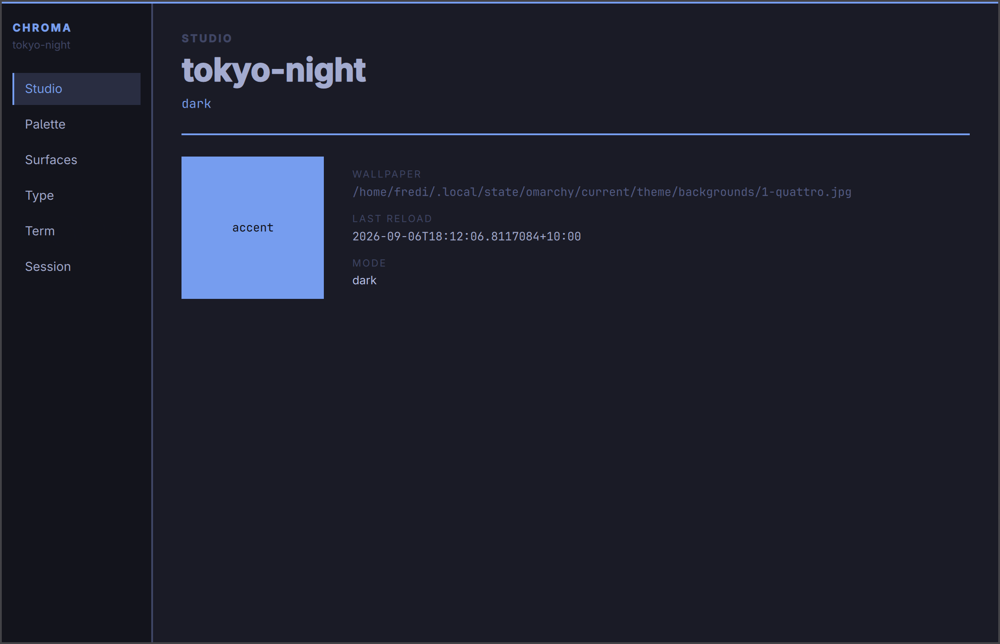

# Chroma

An experiment in writing Omarchy desktop apps with C# on .NET 10 and Qt 6.

Chroma is the vehicle: a live theme studio. It reads `omarchy-theme-color --all` and paints the window from that palette. Switch themes and every page retints in place. Logic lives in C#. The UI is QML through Qt Bridge for C#.



Eleven pages share one `App.Page` nav: Studio, Palette, Surfaces, Type, Term, Controls, Wall, Keys, Notify, Editor, Session.

Hyprland keeps the 2px SSD border. The client draws a matching 2px accent rule. The window is a headerless `Window`, not an `ApplicationWindow`.

## Stack

- .NET 10, `net10.0`
- Qt 6 from `/usr` (`/usr/lib/cmake/Qt6/Qt6Config.cmake`)
- `QtGroup.Qt.Bridge.CSharp.linux-x64` `0.3.*-*`
- QML for the shell, C# for parse, watch, and session
- Omarchy theme data from `omarchy-theme-color --all` only

## Build

```bash
export QtDir=/usr
dotnet test tests/Chroma.Tests/Chroma.Tests.csproj
dotnet build src/Chroma/Chroma.csproj -p:QtDir=/usr
```

The Qt project skips `cmake --install` (Arch's `libfcitx5platforminputcontextplugin.so` has no ELF RPATH). It still copies QML into `Application/` next to the native host. Run that host from the output directory so it uses system `libQt6*.so` and can load `Application/Main.qml`.

```bash
src/Chroma/bin/Debug/net10.0/Chroma
```

## Install

After a Release or Debug build on Linux:

```bash
packaging/install.sh src/Chroma/bin/Debug/net10.0
```

With no argument, `install.sh` picks the newest `net10.0` folder under `src/Chroma/bin/`. It copies the build into `~/.local/share/chroma/`, symlinks `~/.local/bin/chroma` to the native host, and installs `~/.local/share/applications/org.omarchy.chroma.desktop` with `Exec` set to that symlink. Ensure `~/.local/bin` is on your `PATH`, then launch:

```bash
chroma
```

Desktop entry id: `org.omarchy.chroma`.

QML binds colors through a singleton named `Theme`. Do not rename it to `Palette`. Qt Quick already owns that type, and `Palette.background` stays the default white.

## Theme-set hook

The hook pings `$XDG_RUNTIME_DIR/chroma.sock`. If `nc` cannot reach the socket, it writes `$XDG_RUNTIME_DIR/chroma.stamp`. Both paths call the same Reload. After a successful read, Chroma writes accent, background, and mode to `$XDG_RUNTIME_DIR/chroma.palette`.

```bash
omarchy hook install theme-set packaging/chroma-theme-set
```

You can also install the hook from the Session page.

## Desktop file

`packaging/org.omarchy.chroma.desktop` uses `Exec=chroma` (application id `org.omarchy.chroma`). `packaging/install.sh` rewrites `Exec` to your `~/.local/bin/chroma` symlink. For a manual install, put a `chroma` wrapper on `PATH` or point `Exec` at the built host under `src/Chroma/bin/`.
